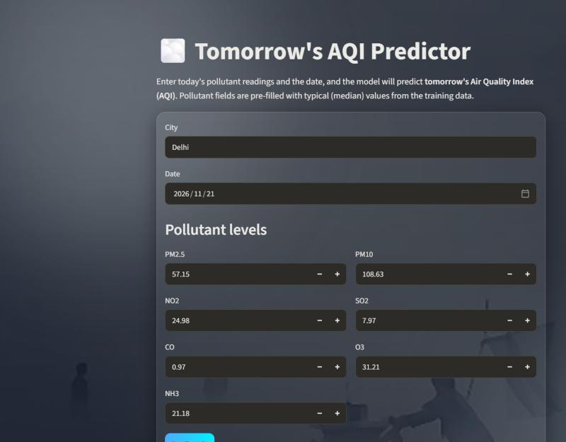

# 🌫️ AQI Prediction for Indian Cities

> A machine learning app that predicts daily Air Quality Index (AQI) from pollutant readings, helping authorities estimate air quality when sensor data is missing and issue timely health advisories.

---

## 🎬 Demo



- **Live app:** [add Streamlit Community Cloud link here, if deployed]

---

## 🎯 Problem Statement and Impact

Air quality sensors across Indian cities often have gaps, delays, or failures. This project predicts daily AQI from pollutant readings [and previous days' values] so that:

- **Pollution control boards** can estimate AQI when a sensor is missing or faulty.
- **Health authorities** can issue advisories when air quality turns Poor or Severe.

**Task type:** Regression
**Target variable:** `AQI`
**Success metric:** MAE and RMSE on a held-out test set, compared against a baseline model.

---

## 📊 Dataset

- **Source:** [Air Quality Data in India (2015 - 2020)](PASTE-KAGGLE-LINK-HERE) on Kaggle (file used: `city_day.csv`)
- **Size:** [rows] rows, [columns] columns, [number] cities
- **Period:** 2015 to 2020
- **Features:** PM2.5, PM10, NO, NO2, NOx, NH3, CO, SO2, O3, Benzene, Toluene, Xylene, City, Date [edit to match what you actually use]
- **Target:** AQI

---

## 🛠️ Approach

1. **Problem definition:** user, target, and success metric defined before touching data.
2. **EDA:** missing values, duplicates, outliers, trends over time, city-wise comparison, correlations.
3. **Preprocessing:** [missing value method and why], [outlier treatment and why], date-based features, encoding of City, scaling.
4. **Data split:** time-based split ([train years] for training, [test years] for testing) to avoid leakage. All transformers fit on training data only.
5. **Modeling:** baseline Linear Regression, then Decision Tree, Random Forest, and [Gradient Boosting / other].
6. **Validation and tuning:** time-aware cross-validation and [GridSearchCV / RandomizedSearchCV], with fixed random seeds.
7. **Interpretation:** [feature importance / permutation importance / SHAP].
8. **Error analysis:** where and why the model fails.
9. **Deployment:** saved scikit-learn Pipeline (joblib) served through a Streamlit app.

---

## 📈 Results

| Model | MAE | RMSE | R² |
|---|---|---|---|
| Linear Regression (baseline) | [ ] | [ ] | [ ] |
| Decision Tree | [ ] | [ ] | [ ] |
| Random Forest | [ ] | [ ] | [ ] |
| [Gradient Boosting] | [ ] | [ ] | [ ] |

**Best model:** [name], with [x]% lower MAE than the baseline.

---

## 💡 Key Insights and Findings

- [Insight 1, e.g. which pollutant drives AQI the most]
- [Insight 2, e.g. seasonal pattern: winter months show the highest AQI]
- [Insight 3, e.g. which cities are the most polluted]
- **Error analysis:** [e.g. the model underpredicts extreme AQI values because they are rare in the training data]

---

## 🧗 Challenges Faced

| Challenge | How I solved it |
|---|---|
| [e.g. High share of missing values in some columns] | [your solution] |
| [e.g. Risk of data leakage in time-series data] | [your solution] |
| [Add your own] | [your solution] |

---

## ▶️ How to Run Locally

```bash
# 1. Clone the repository
git clone https://github.com/[your-username]/[repo-name].git
cd [repo-name]

# 2. Create and activate a virtual environment
python -m venv venv
# Windows
venv\Scripts\activate
# macOS / Linux
source venv/bin/activate

# 3. Install dependencies
pip install -r requirements.txt

# 4. Run the app
streamlit run app.py
```

---

## 📁 Project Structure

```
aqi-prediction/
|-- README.md
|-- requirements.txt
|-- app.py
|-- data/            # sample data or link to source
|-- notebooks/
|   |-- 01_eda.ipynb
|   |-- 02_modeling.ipynb
|-- src/             # preprocessing, training, utility code
|-- models/          # saved model files
|-- images/          # screenshots used in the README
|-- .gitignore
```

---

## ⚠️ Limitations and Future Improvements

**Limitations**
- Trained on historical data (2015 to 2020), not live sensor feeds.
- 2020 lockdowns make that year's readings unusual.
- Performance varies across cities and is weaker for extreme AQI values.

**Future improvements**
- Add weather data (temperature, humidity, wind) as features.
- Connect live readings from a public API (e.g. OpenAQ) to the saved model.
- Next-day AQI forecasting with lag features.
- Deploy online with Streamlit Community Cloud or FastAPI.

---

## 🧰 Tech Stack

Python · Pandas · NumPy · Matplotlib / Seaborn · Scikit-learn · [SHAP] · Joblib · Streamlit · Git / GitHub

---

## 📬 Contact

**Madhav N Aju**
- LinkedIn: [your LinkedIn URL]
- Email: [your email]
- GitHub: [your GitHub profile URL]
