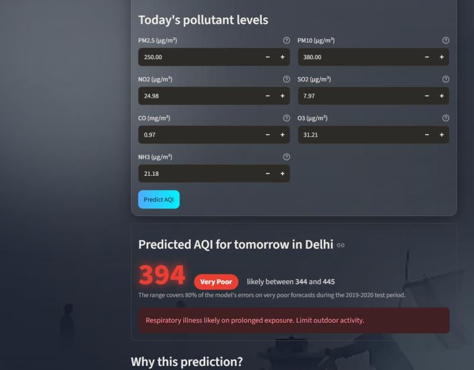
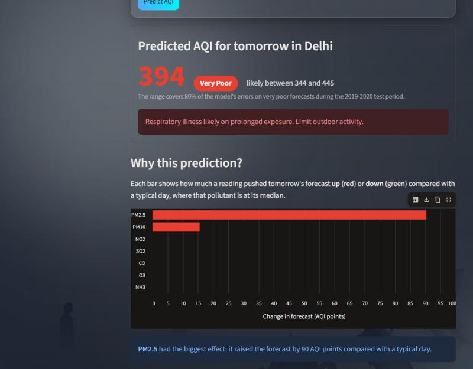
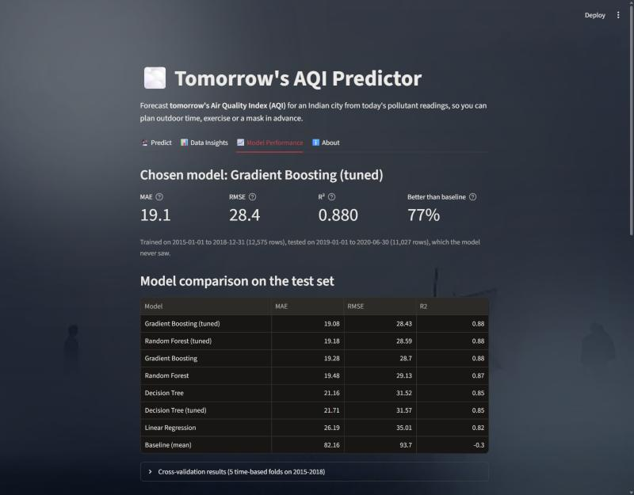
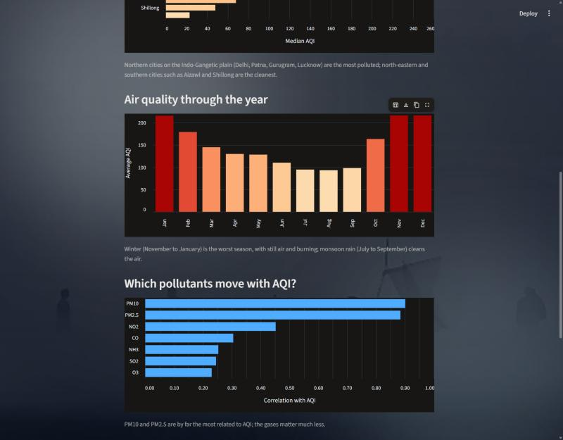

# 🌫️ AQI Prediction for Indian Cities

> Forecasts **tomorrow's Air Quality Index (AQI)** for Indian cities from today's pollutant readings, so people can plan outdoor time, exercise or a mask a day in advance. The forecast is within about **19 AQI points on average** on unseen 2019-2020 data.

---

## 🎬 Demo

| Prediction | Why this prediction? |
|---|---|
|  |  |

| Model Performance tab | Data Insights tab |
|---|---|
|  |  |

- **Live app:** [add Streamlit Community Cloud link here, if deployed]

---

## 🎯 Problem Statement and Impact

Air pollution is one of India's biggest health risks, and it changes from day to day. **Who benefits:**
- **Commuters, parents, outdoor workers, students and the elderly**, who can decide in advance whether to limit time outside, move exercise indoors, wear a mask or keep children inside.
- **People with asthma or heart or lung conditions**, for whom bad-air days are dangerous.

**Task type:** regression
**Target variable:** `AQI_tomorrow`, the same city's AQI on the next day
**Inputs:** today's PM2.5, PM10, NO2, SO2, CO, O3 and NH3, plus the date (month, day of week, season)
**Success metric:** **MAE**, the average number of AQI points the forecast is off by. It is easy to explain to users and robust to a few extreme days. RMSE and R² are also reported, and every model must beat a baseline that always predicts the average.

---

## 📊 Dataset

- **Source:** [Air Quality Data in India (2015 - 2020)](https://www.kaggle.com/datasets/rohanrao/air-quality-data-in-india) on Kaggle (file: `city_day.csv`, from CPCB monitoring stations)
- **Size:** 29,531 rows × 16 columns, 26 cities
- **Period:** 1 January 2015 to 1 July 2020
- **Columns:** City, Date, PM2.5, PM10, NO, NO2, NOx, NH3, CO, SO2, O3, Benzene, Toluene, Xylene, AQI, AQI_Bucket
- **Features used:** PM2.5, PM10, NO2, SO2, CO, O3, NH3, month, day of week, season (one-hot)
- **Target:** tomorrow's AQI, created by shifting each city's AQI by one day (23,602 usable rows after cleaning)

---

## 🛠️ Approach

1. **Problem definition:** user, target and success metric were written down before touching the data.
2. **EDA** ([`notebooks/01_eda.ipynb`](notebooks/01_eda.ipynb)): missing values, duplicates, outliers, correlations with AQI, trends over time, city comparison and class balance, with a written insight under every result.
3. **Data cleaning:**
   - Found that Ahmedabad's CO column was a **copy of NO** in 1,317 rows, which caused every AQI above 500 in that city; those rows were dropped.
   - Capped AQI at 500, the official scale maximum.
   - Dropped Benzene, Toluene and Xylene (mostly missing and weakly related to AQI).
4. **Target:** each city's AQI shifted back by one day, and only when the next row is exactly one day later.
5. **Time-based split:** trained on 2015-2018, tested on 2019 to mid-2020. The split happens before anything is fitted, so there is no leakage.
6. **Features:** month, day of week and one-hot season, because EDA showed a strong winter/monsoon cycle.
7. **Pipeline:** `SimpleImputer(median)` → (`StandardScaler` for Linear Regression) → model, so missing-value filling is learned from training data only.
8. **Modeling** ([`notebooks/02_modeling.ipynb`](notebooks/02_modeling.ipynb)): a baseline (`DummyRegressor`), Linear Regression, Decision Tree, Random Forest and Gradient Boosting.
9. **Validation and tuning:** 5-fold **`TimeSeriesSplit`** cross-validation (never trains on the future), with `GridSearchCV` (Decision Tree) and `RandomizedSearchCV` (Random Forest, Gradient Boosting). `random_state=42` everywhere.
10. **Interpretation:** permutation importance on the test set.
11. **Error analysis:** errors by city, season, AQI category and month, plus the largest misses.
12. **Deployment:** the whole Pipeline is saved with joblib and served in a Streamlit app.

---

## 📈 Results

Test set: 2019-01-01 to 2020-06-30 (11,027 rows the model never saw). Models were chosen by cross-validated MAE on 2015-2018.

| Model | CV MAE (5 folds) | Test MAE | Test RMSE | Test R² |
|---|---|---|---|---|
| Baseline (always predicts the mean) | 95.91 | 82.17 | 93.71 | -0.301 |
| Linear Regression | 38.96 | 26.19 | 35.01 | 0.818 |
| Decision Tree | 33.23 | 21.16 | 31.53 | 0.853 |
| Decision Tree (tuned) | 31.47 | 21.71 | 31.57 | 0.852 |
| Random Forest | 29.73 | 19.48 | 29.13 | 0.874 |
| Random Forest (tuned) | 28.76 | 19.19 | 28.59 | 0.879 |
| Gradient Boosting | 29.37 | 19.28 | 28.71 | 0.878 |
| **Gradient Boosting (tuned)** ✅ | **28.69** | **19.08** | **28.43** | **0.880** |

**Best model:** tuned Gradient Boosting (400 trees, depth 3, learning rate 0.03, subsample 0.85, min 20 samples per leaf), with **77% lower MAE than the baseline**. 80% of its test forecasts were within ±28 AQI points.

> CV errors are higher than test errors because the early folds train on only one or two years of data. CV is used to **compare** models; the test set gives the final score.

---

## 💡 Key Insights and Findings

- **PM2.5 drives the forecast.** Shuffling it worsens the MAE by about 32 points, and PM10 by about 15; the other gases and date features add little. This matches how Indian AQI is defined: the worst pollutant (usually particulate matter) sets the day's AQI.
- **Strong seasonal cycle.** Average AQI is about 217 in November to January (winter smog) and about 95 in July to September (monsoon rain cleans the air). Day of week barely matters.
- **The north is most polluted.** Delhi (median AQI 257), Patna, Gurugram and Lucknow lead; Aizawl (23) and Shillong (48) are the cleanest.
- **Air quality improved every year**, from an average of 196 in 2015 to 108 in 2020 (helped by the COVID lockdown).
- **Error analysis:**
  - Errors are largest in **winter** (MAE 23.0, against 15.5 in monsoon) and in polluted northern cities.
  - The model is **pulled towards the middle**: it under-predicts **Severe** days by 37 points on average and over-predicts **Good** days by 19.
  - Severe days are only 3% of the data, and the model has no weather inputs.
  - The largest misses are sudden one-day spikes (for example Guwahati, 11 August 2019: actual 488, predicted 113).

---

## 🧗 Challenges Faced

| Challenge | How I solved it |
|---|---|
| AQI values above 2,000, far beyond the official 500 limit | Traced them to Ahmedabad, found its CO column was a copy of NO in 66% of rows (and in all 412 extreme days), dropped those rows and capped AQI at 500 |
| Up to 38% missing values in key pollutants (PM10, NH3) | Median imputation inside a scikit-learn Pipeline, so it is learned from training data only |
| Risk of data leakage in time-series data | Date-based train/test split, `TimeSeriesSplit` cross-validation, and the test set used only once |
| "Tomorrow" could silently jump over gaps in the data | Target only kept when the next row is exactly one day later |
| App and training could prepare inputs differently | Shared feature code in `src/features.py`, and the full Pipeline saved as one file |
| Model files were git-ignored, so the app broke after cloning | Committed the small model files (about 0.5 MB) |

---

## ▶️ How to Run Locally

```bash
# 1. Clone the repository
git clone https://github.com/madhavnnnnnnnnnnnn/AQI-Prediction-for-Indian-Cities.git
cd AQI-Prediction-for-Indian-Cities

# 2. Create and activate a virtual environment
python -m venv venv
# Windows
venv\Scripts\activate
# macOS / Linux
source venv/bin/activate

# 3. Install dependencies
pip install -r requirements.txt

# 4. Run the app
streamlit run app.py

# Optional: re-run the analysis and retrain the model
jupyter notebook notebooks/
```

---

## ✨ App Features

Four tabs: **Predict**, **Data Insights**, **Model Performance** and **About**.

- **Prediction with a likely range:** for example "394, Very Poor, likely between 344 and 445". The range comes from the model's real test errors for that category.
- **Why this prediction?:** shows how much each reading pushed the forecast up or down compared with a typical day.
- **Input validation:**
  - sensible limits and units for every field
  - warnings for unusual readings (for example PM2.5 above PM10)
  - friendly errors instead of crashes, even if the model files are missing
- **Data Insights:** the most polluted cities, the seasonal cycle, the pollutant correlations and the trend for any city.
- **Model Performance:** model comparison, cross-validation results, tuned settings, feature importance and error analysis.
- **Design:** smog photo background, drifting smog animation, frosted-glass cards and a glowing AQI value. Animations turn off for users who prefer reduced motion.

---

## 📁 Project Structure

```
AQI-Prediction-for-Indian-Cities/
|-- README.md
|-- requirements.txt
|-- app.py                     # Streamlit app (4 tabs)
|-- background.jpg             # app background image
|-- data/
|   |-- city_day.csv           # raw dataset (Kaggle)
|-- notebooks/
|   |-- 01_eda.ipynb           # exploratory data analysis
|   |-- 02_modeling.ipynb      # cleaning, CV, tuning, evaluation, error analysis
|-- src/
|   |-- config.py              # paths, feature list, constants
|   |-- data.py                # loading, target creation, cleaning, split
|   |-- features.py            # date features, AQI categories (shared with the app)
|   |-- style.py               # app CSS
|-- models/
|   |-- best_model.pkl         # saved Pipeline (imputer + tuned Gradient Boosting)
|   |-- fill_values.pkl        # training medians (form defaults)
|   |-- feature_cols.json      # feature order
|   |-- metrics.json           # results shown in the app
|-- images/                    # screenshots used in this README
|-- .gitignore
```

---

## ⚠️ Limitations and Future Improvements

**Limitations**
- No weather data (wind, rain, temperature, humidity), which explains many sudden spikes and drops.
- Under-predicts rare Severe days (3% of the data).
- Trained on 2015-2020 data, not live sensor feeds; 2020 was unusually clean because of the lockdown.
- Ahmedabad lost most of its rows to the copied-CO problem, so forecasts there are less reliable.

**Future improvements**
- Add weather data and lag features (today's AQI had the strongest correlation with tomorrow's: 0.91).
- Weight rare Severe days more, or try quantile models, to reduce under-prediction.
- Retrain on recent data and connect live readings from a public API (for example OpenAQ or CPCB).
- Deploy on Streamlit Community Cloud, or serve the model with FastAPI.

---

## 🧰 Tech Stack

Python · Pandas · NumPy · Matplotlib · Seaborn · Scikit-learn (Pipeline, TimeSeriesSplit, GridSearchCV, RandomizedSearchCV, permutation importance) · Joblib · Streamlit · Altair · Git / GitHub

---

## 📬 Contact

**Madhav N Aju**
- LinkedIn: [your LinkedIn URL]
- Email: [your email]
- GitHub: [madhavnnnnnnnnnnnn](https://github.com/madhavnnnnnnnnnnnn)
